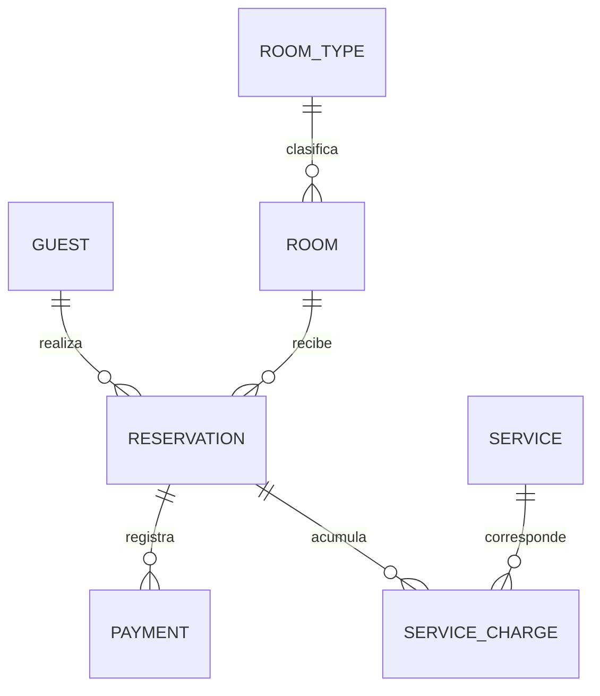

# Comprehensive Hotel Management and Administration System

**Proyecto:** Database Design Project - Stage 2 of 2  
**Autores:** Dylan Espinoza y Jose Reinoso  
**Fecha de la especificación:** 16 de noviembre de 2026  
**Tecnología utilizada:** MySQL 8.0 (InnoDB, `utf8mb4`) y Docker  
**Base de datos:** `hotel_management`

> **Sobre esta documentación:** Este README resume la especificación `pj2.pdf`, sus modelos y los resultados de las pruebas que constan en el informe. Los nombres de los scripts SQL se toman del documento; sus archivos fuente no se incluyen en este README. Los comandos de reproducción son una guía y pueden necesitar ajustes según la instalación de MySQL.

## 1. Descripción general

El proyecto propone una base de datos para gestionar un **único hotel**, centralizando la información de huéspedes, tipos de habitación, habitaciones, reservas, pagos y servicios adicionales.

El sistema permite registrar reservas por habitación, consultar disponibilidad, conservar los precios acordados en cada transacción, registrar pagos parciales y calcular balances pendientes. Cada reserva corresponde a **un huésped y una habitación**; si un huésped solicita varias habitaciones, se crean varias reservas.

**Fuera del alcance:** múltiples hoteles, nómina, inventario del restaurante, tareas de limpieza, precios dinámicos, reservas web y procesamiento de pagos con entidades bancarias.

## 2. Evolución desde Stage 1

| Elemento | Stage 1 | Stage 2 |
|---|---|---|
| Modelo conceptual | Siete entidades y seis relaciones, con representación preliminar | Diagrama en notación Chen, relaciones nombradas y cardinalidades explícitas |
| Modelo lógico | Propuesta de tablas y relaciones | Diagrama reorganizado, con `reservation` en el centro y atributos/tipos de datos especificados |
| Integridad | Claves primarias y foráneas como base del diseño | Restricciones `NOT NULL`, `UNIQUE`, `CHECK`, políticas referenciales e índices |
| Normalización | Propuesta de estructura relacional | Justificación de 1NF, 2NF y 3NF |
| Implementación | Prevista para la siguiente etapa | Descrita para MySQL 8.0, con scripts SQL |
| Validación | Casos pendientes | 18 casos de prueba y capturas de consola |
| Documentación | Propuesta y requisitos | Diccionario de datos, convenciones, referencias y declaración de IA |

**Importante:** No se sustituyeron las siete entidades ni las seis relaciones fundamentales. Las correcciones principales sobre los diagramas fueron de **claridad visual**, mientras que las restricciones, consultas, implementación y pruebas representan el avance técnico.

## 3. Requisitos

### 3.1 Requisitos funcionales

| ID | Funcionalidad |
|---|---|
| FR_01 | Registrar y actualizar datos de huéspedes |
| FR_02 | Registrar tipos de habitación y habitaciones |
| FR_03 | Buscar habitaciones con capacidad suficiente y libres en un rango de fechas |
| FR_04 | Crear una reserva para un huésped y una habitación |
| FR_05 | Detectar reservas activas superpuestas de la misma habitación |
| FR_06 | Actualizar estados de entrada, salida y cancelacion y conservar fechas reales |
| FR_07 | Registrar pagos con monto, fecha, método y estado |
| FR_08 | Gestionar catálogo de servicios y cargos asociados a reservas |
| FR_09 | Consultar cargos, pagos y saldo de una reserva |
| FR_10 | Localizar reservas por huésped, fecha, habitación o estado |

### 3.2 Requisitos no funcionales

| ID | Objetivo |
|---|---|
| NFR_01 | Consultas de disponibilidad y acceso a reservas en menos de 3 segundos en condiciones normales |
| NFR_02 | Acceso autorizado según roles, protección de credenciales y conexiones cifradas |
| NFR_03 | Disponibilidad durante operaciones del hotel y recuperación tras interrupciones |
| NFR_04 | Copias de seguridad diarias y pruebas de restauración |
| NFR_05 | Integridad de campos, fechas, montos y referencias |
| NFR_06 | Agregar nuevas categorías y servicios sin modificar reservas existentes |

**Alcance de la validación:** NFR_01 se verifico solamente con datos pequeños y una consulta a la vez. NFR_02 y NFR_04 no se implementaron ni probaron como políticas operativas; NFR_03 se verifico con un reinicio del contenedor, no con una prueba de alta disponibilidad.

## 4. Modelo conceptual y modelo lógico

### 4.1 Entidades

1. `guest`: huésped, identificación y contacto.
2. `room_type`: nombre de categoría, capacidad y tarifa base.
3. `room`: número, piso, tipo y estado operativo.
4. `reservation`: huésped, habitación, fechas, tarifa acordada y estado.
5. `payment`: pagos asociados a una reserva.
6. `service`: catálogo de servicios y sus precios actuales.
7. `service_charge`: servicios consumidos durante una reserva, con fecha, cantidad y precio histórico.

### 4.2 Relaciones



Todas son relaciones **1:N**. En cada una, la clave foránea se coloca del lado **N**. Por ejemplo, `reservation.guest_id` referencia `guest.guest_id` y `reservation.room_id` referencia `room.room_id`.

`service_charge` resuelve la relación muchos-a-muchos conceptual entre reservas y servicios; se conserva como tabla independiente porque un mismo servicio se puede cobrar varias veces a una misma reserva, en diferentes fechas, cantidades o precios.

### 4.3 Tablas y atributos

```text
guest(
  guest_id PK, full_name, identification_number UQ, phone?, email? UQ
)
room_type(
  room_type_id PK, name UQ, capacity, base_nightly_rate
)
room(
  room_id PK, room_type_id FK, room_number UQ, floor, status
)
reservation(
  reservation_id PK, guest_id FK, room_id FK,
  check_in_date, check_out_date, nightly_rate, status,
  actual_check_in_date?, actual_check_out_date?
)
payment(
  payment_id PK, reservation_id FK, amount,
  payment_date, payment_method, status
)
service(
  service_id PK, name UQ, description?,
  standard_price, availability_status
)
service_charge(
  service_charge_id PK, reservation_id FK, service_id FK,
  service_date, quantity, unit_price
)
```

`?` indica campo opcional (admite `NULL`). `PK` es clave primaria; `FK`, clave foránea; `UQ`, restricción de unicidad. Los identificadores son enteros autoincrementales. Las fechas utilizan `DATE`, los importes `DECIMAL(10,2)` y los textos `VARCHAR` con el tamaño definido en el diccionario de datos del PDF.

### 4.4 Normalización hasta 3NF

- **1NF:** los campos son atómicos; los múltiples pagos o servicios se guardan como filas independientes.
- **2NF:** las tablas usan claves primarias simples, evitando dependencias parciales de claves compuestas.
- **3NF:** atributos como capacidad y tarifa base dependen de `room_type`, no de `room`; la descripción del servicio depende de `service` y no de `service_charge`.
- **Precios históricos:** `reservation.nightly_rate` y `service_charge.unit_price` son valores de transacción; no deben cambiar cuando se actualizan `room_type.base_nightly_rate` o `service.standard_price`.
- **Totales:** el saldo se calcula con consultas, no se guarda como dato duplicado.

## 5. Reglas de negocio y controles de integridad

| Regla | Como se aborda |
|---|---|
| BR_1: salida posterior a entrada | `CHECK` sobre las fechas de la reserva |
| BR_2: no superponer reservas activas | Consulta previa de conflictos; **no** hay una restricción automática que lo impida |
| BR_3: canceladas y finalizadas no bloquean | El filtro de disponibilidad considera `booked` y `checked_in` |
| BR_4: mantenimiento o fuera de servicio no reservable | Filtro de `room.status = 'available'`; no existe bloqueo obligatorio ante un `INSERT` directo |
| BR_5: pagos y cantidades positivos | `CHECK` para `payment.amount` y `service_charge.quantity` |
| BR_6: conservar el precio de la transacción | Columnas `nightly_rate` y `unit_price` propias de la reserva/cargo |

Otros controles utilizados:

- **`NOT NULL`** en campos obligatorios.
- **`UNIQUE`** en documento y correo de huésped, nombre del tipo de habitación, número de habitación y nombre de servicio.
- **`FOREIGN KEY` y `ON DELETE RESTRICT`** para conservar el historial relacionado y evitar registros huérfanos.
- **`CHECK`** para estados permitidos, precios no negativos y fechas válidas.
- **Índices** sobre columnas frecuentes en búsquedas, fechas, estados y claves foráneas.

## 6. Entorno y archivos SQL

El informe registra una ejecución en **MySQL 8.0.33**, dentro del contenedor Docker **`mysqlcontainer2`**, usando la base **`hotel_management`**.

Estructura de archivos **mencionada en la especificación**:

```text
hotel-management/
├── README.md
├── pj2.pdf
└── sql/
    ├── 01_schema.sql          # Definicion de tablas, claves, restricciones e indices
    ├── 02_sample_data.sql     # Datos de ejemplo
    └── 03_queries.sql         # Consultas de negocio
```

### 6.1 Conexion con MySQL mediante Docker

Desde Ubuntu:

```bash
docker ps
docker exec -it mysqlcontainer2 mysql -u root -p
```

El comando anterior supone que el contenedor está iniciado, que existe el usuario `root` y que se conoce su contraseña. Si el contenedor tiene otro nombre, sustituir `mysqlcontainer2`.

Dentro de MySQL:

```sql
SHOW DATABASES;
USE hotel_management;
SHOW TABLES;
DESCRIBE reservation;
```

Para cargar scripts locales, **si los archivos SQL originales están disponibles**, copiarlos primero al contenedor:

```bash
docker cp sql/01_schema.sql mysqlcontainer2:/tmp/01_schema.sql
docker cp sql/02_sample_data.sql mysqlcontainer2:/tmp/02_sample_data.sql
docker cp sql/03_queries.sql mysqlcontainer2:/tmp/03_queries.sql
```

Luego entrar a MySQL y ejecutar:

```sql
CREATE DATABASE IF NOT EXISTS hotel_management;
USE hotel_management;
SOURCE /tmp/01_schema.sql;
SOURCE /tmp/02_sample_data.sql;
SOURCE /tmp/03_queries.sql;
```

**Atención:** Si la base ya tiene tablas o datos, no volver a cargar indiscriminadamente los scripts: podrian producirse conflictos por objetos existentes o IDs duplicados. Para reproducir exactamente los tests se necesita un estado inicial limpio y el orden de ejecución indicado en la especificación.

## 7. Metodología de pruebas

Las pruebas se ejecutaron **manualmente en la consola de MySQL**, documentando comandos, resultados y capturas de pantalla. El informe declara que los casos TC-01 a TC-18 se ejecutaron **en orden**, por lo que algunos casos dependieron de los registros creados o modificados por casos anteriores.

Cada prueba se documento con los campos:

- **Test ID:** identificador, por ejemplo `TC-03`.
- **Req. ID:** requisito asociado, por ejemplo `FR_03`.
- **Descripción:** comportamiento que se quiere comprobar.
- **Preconditions:** tablas y datos que deben existir antes.
- **Steps:** consultas o cambios de datos que se realizan.
- **Expected Result:** resultado correcto esperado.
- **Status:** resultado registrado, en el documento `Passed`.

En pruebas negativas, **rechazar la operación es el resultado correcto**: un mensaje de error puede significar que el control de integridad funciona.

## 8. Registro de los 18 casos de prueba

| Caso | Requisito | Operación ejecutada | Resultado documentado |
|---|---|---|---|
| TC-01 | FR_01 | Insertar a Diego Paredes y actualizar el teléfono | Huésped `guest_id=6`; teléfono final `0987776655` |
| TC-02 | FR_02 | Crear categoría Family y habitación 401 | Categoría con capacidad 5, tarifa 150.00; habitación disponible |
| TC-03 | FR_03 | Buscar disponibilidad para 2 personas, del 11 al 13 de diciembre de 2026 | Habitaciones 102, 302 y 401 |
| TC-04 | FR_04 | Crear reserva del 20 al 23 de diciembre en habitación 302 | `reservation_id=5`, tarifa 70.00, estado `booked` |
| TC-05 | FR_05 | Consultar conflicto de habitación 202 del 14 al 16 de diciembre y después insertar reservas solapadas sin validar | Consulta detecta reserva 2; la BD **permite** las inserciones directas (reservas 6 y 7) |
| TC-06 | FR_06 | Registrar entrada y salida real en reserva 2 y cancelar reserva 5 | Reserva 2 termina `checked_out`; reserva 5 `cancelled` |
| TC-07 | FR_07 | Registrar dos pagos para reserva 4: 75.00 y 100.00 | Dos pagos completados, total 175.00 |
| TC-08 | FR_08 | Cobrar dos desayunos a 8.00 y cambiar precio de catálogo a 9.50 | Cargo histórico de 16.00; el precio original 8.00 permanece |
| TC-09 | FR_09 | Calcular cargos, pagos y saldo de reserva 4 | Habitación 140.00 + servicios 51.00 - pagos 175.00 = saldo 16.00 |
| TC-10 | FR_10 | Buscar reservas por huésped, fecha, habitación y estado | Resultados para cada criterio; habitación 202 devuelve reservas 2, 6 y 7 |
| TC-11 | NFR_01 | Medir tiempo de consulta de disponibilidad | Consola muestra 0.00 s con datos pequeños; no hay prueba concurrente |
| TC-12 | NFR_03 | Contar filas, detener/reiniciar contenedor y contar otra vez | Persisten 6 huéspedes, 7 habitaciones, 7 reservas y 5 pagos |
| TC-13 | NFR_05 | Insertar huésped con nombre `NULL` | Rechazado, `ERROR 1048` |
| TC-14 | NFR_06 | Crear tipo Penthouse y servicio Parking | Nuevos registros creados sin alterar las siete reservas existentes |
| TC-15 | FR_01 | Insertar huésped con documento de identificación duplicado | Rechazado, `ERROR 1062` |
| TC-16 | FR_02 | Crear tipo de habitación con capacidad 0 | Rechazado, `ERROR 3819` |
| TC-17 | FR_04 | Crear reserva con misma fecha de entrada y salida | Rechazado, `ERROR 3819` |
| TC-18 | FR_07 | Registrar pago negativo de -10.00 | Rechazado, `ERROR 3819` |

En el PDF todos los casos están registrados como **Passed**, con evidencias visuales en las Figuras 3 a 20 (páginas 15 a 23). El resultado de `TC-05` es especialmente importante: la prueba **documenta una limitación**, no una protección automática completa.

## 9. Consultas SQL explicadas

### 9.1 Detectar superposición de reservas (TC-05)

Consulta documentada para la habitación con `room_id = 4`, del 14 al 16 de diciembre:

```sql
SELECT reservation_id, check_in_date, check_out_date, status
FROM reservation
WHERE room_id = 4
  AND status IN ('booked', 'checked_in')
  AND check_in_date < '2026-12-16'
  AND check_out_date > '2026-12-14';
```

Interpretación: si el resultado **devuelve filas**, hay al menos una reserva activa que se cruza con el nuevo intervalo y la aplicación **no debería** guardar una reserva adicional. La fecha de salida se considera el primer día **no ocupado**; por eso es válido reservar a partir del día de salida de otra reserva.

**Límite técnico:** este `SELECT` por si solo no impide un `INSERT` directo. La protección completa requiere una estrategia de validación atómica en el servidor y manejo de concurrencia.

### 9.2 Buscar habitaciones disponibles (TC-03)

Ejemplo equivalente a la consulta del documento para una capacidad mínima de 2 y el intervalo 11-13 de diciembre:

```sql
SELECT r.room_number,
       t.name AS room_type,
       t.capacity,
       t.base_nightly_rate
FROM room AS r
JOIN room_type AS t ON t.room_type_id = r.room_type_id
WHERE r.status = 'available'
  AND t.capacity >= 2
  AND NOT EXISTS (
      SELECT 1
      FROM reservation AS x
      WHERE x.room_id = r.room_id
        AND x.status IN ('booked', 'checked_in')
        AND x.check_in_date < '2026-12-13'
        AND x.check_out_date > '2026-12-11'
  );
```

Esta versión usa `NOT EXISTS` y es equivalente en objetivo a la consulta con `NOT IN` presentada en la especificación. Solo devuelve habitaciones operativamente disponibles, de capacidad suficiente y sin reservas activas que se crucen con las fechas.

### 9.3 Calcular un saldo (TC-09)

```sql
-- Cargo por habitacion
SELECT DATEDIFF(check_out_date, check_in_date) * nightly_rate AS room_charge
FROM reservation
WHERE reservation_id = 4;

-- Cargo por servicios
SELECT COALESCE(SUM(quantity * unit_price), 0) AS service_total
FROM service_charge
WHERE reservation_id = 4;

-- Pagos completados
SELECT COALESCE(SUM(amount), 0) AS paid_total
FROM payment
WHERE reservation_id = 4
  AND status = 'completed';
```

`DATEDIFF` calcula las noches, `SUM` suma los importes y `COALESCE` convierte un `NULL` de suma vacía en `0`. El saldo se obtiene con `room_charge + service_total - paid_total`.

**Datos de TC-09:** `140.00 + 51.00 - 175.00 = 16.00`.

### 9.4 Consultar estados y datos relacionados

```sql
-- Ejemplo de busqueda por numero de habitacion
SELECT v.reservation_id, r.room_number, v.check_in_date,
       v.check_out_date, v.status
FROM reservation AS v
JOIN room AS r ON r.room_id = v.room_id
WHERE r.room_number = '202';

-- Ejemplo de verificacion de registros por tabla
SELECT COUNT(*) AS total_guests FROM guest;
SELECT COUNT(*) AS total_rooms FROM room;
SELECT COUNT(*) AS total_reservations FROM reservation;
SELECT COUNT(*) AS total_payments FROM payment;
```

Las consultas de este apartado son útiles para estudiar y repetir pruebas, pero no sustituyen los scripts originales ni el registro exacto de las sentencias ejecutadas manualmente.

## 10. Significado de los errores de las pruebas negativas

| Error MySQL | Caso | Significado |
|---|---|---|
| `ERROR 1048` | TC-13 | Se intentó asignar `NULL` a un campo obligatorio (`NOT NULL`) |
| `ERROR 1062` | TC-15 | Se intentó insertar un valor duplicado en una columna `UNIQUE` |
| `ERROR 3819` | TC-16 | Se intentó guardar una capacidad que no supera 0 (`CHECK`) |
| `ERROR 3819` | TC-17 | La fecha de salida no es posterior a la de entrada (`CHECK`) |
| `ERROR 3819` | TC-18 | El monto del pago no es positivo (`CHECK`) |

Estos errores son **evidencia positiva de integridad** en dichos casos: el servidor rechazó datos inválidos.

## 11. Prueba de persistencia con Docker (TC-12)

El informe describe una comparación de conteos antes y después de detener y volver a iniciar `mysqlcontainer2`.

Fuera de la consola MySQL, los comandos correspondientes son:

```bash
docker stop mysqlcontainer2
docker start mysqlcontainer2
```

Al reconectar, se repitieron las consultas `COUNT(*)`. Los conteos documentados fueron iguales: 6 huéspedes, 7 habitaciones, 7 reservas y 5 pagos.

**Interpretación correcta:** los datos seguían presentes después de reiniciar el contenedor. **No** demuestra por si mismo que exista una copia de seguridad válida ni que el sistema tenga alta disponibilidad.

## 12. Limitaciones conocidas y trabajo futuro

1. **Conflictos de reservas:** la validación de disponibilidad es una consulta previa, no una restricción que impida todo `INSERT` incorrecto. Debe reforzarse con lógica transaccional segura y control de concurrencia.
2. **Habitaciones fuera de servicio:** las consultas las excluyen, pero una inserción directa podría evitar ese filtro.
3. **Seguridad por roles (NFR_02):** aún no se crean ni verifican cuentas y privilegios separados de recepción y administración.
4. **Backups (NFR_04):** no se documenta una copia diaria automática ni una restauración probada.
5. **Rendimiento (NFR_01):** la medida de 0.00 segundos con pocos registros no valida el rendimiento con grandes volúmenes ni solicitudes concurrentes.
6. **Disponibilidad (NFR_03):** el reinicio comprueba recuperación básica de datos, no continuidad del servicio durante una falla.
7. **Sin interfaz web ni pagos externos:** este entregable es el diseño e implementación de la capa de datos, no un sistema completo de producción.

## 13. Diccionario de datos y convenciones

El **Anexo A** del informe define columna por columna: tipo de dato, `PK`/`FK`/`UQ`, posibilidad de `NULL`, valores permitidos y significado del atributo.

El **Anexo B** define una convención coherente:

- Tablas y columnas en inglés y en `snake_case`: `guest`, `room_type`, `check_in_date`.
- Tablas en singular.
- Claves primarias con la forma `<tabla>_id`: `guest_id`, `reservation_id`.
- Claves foráneas con el mismo nombre del identificador referenciado.
- Restricciones `fk_...`, `uq_...`, `ck_...` e índices `idx_...`.
- Valores de estado como `checked_in` y `out_of_service`.

Se documenta una desviación respecto a una recomendación de la plantilla: usar `<tabla>_id` en lugar de `id` para hacer más explícitos los `JOIN`.

## 14. Evidencias y trazabilidad

- **Fuente principal:** `pj2.pdf`, *Database Design Specification - Stage 2 of 2* (28 páginas).
- **Modelo conceptual:** Figura 1, página 5 del PDF.
- **Modelo lógico:** Figura 2, página 7 del PDF.
- **Pruebas:** tablas de casos, páginas 10-14 del PDF.
- **Capturas de ejecución:** Figuras 3-20, páginas 15-23 del PDF.
- **Limitaciones:** página 10 del PDF.
- **Diccionario y convenciones:** páginas 26-28 del PDF.

La sección de uso de IA del informe identifica asistencia para diagramas, consultas, restricciones y redacción, y atribuye al equipo la ejecución manual de los casos de prueba y la toma de capturas. Se recomienda conservar este registro de contribuciones al presentar el proyecto.

## 15. Conclusiones

La segunda etapa transforma el diseño inicial del hotel en una especificación implementable, organizada y respaldada por pruebas manuales. Se mantienen las siete entidades originales y se documentan seis relaciones 1:N, su implementación mediante claves foráneas, restricciones de integridad, normalización a 3NF, consultas de negocio y 18 casos de prueba.

La verificación con datos de ejemplo demuestra operaciones básicas e integridad de varios campos. Sin embargo, el sistema aún necesita controles automáticos contra superposiciones, seguridad por roles, copias de seguridad y pruebas de concurrencia antes de considerarlo listo para producción.

---

**Referencia:** Espinoza, D., y Reinoso, J. (2026). *Database Design Specification: Comprehensive Hotel Management and Administration System - Stage 2 of 2*. Documento de curso.
